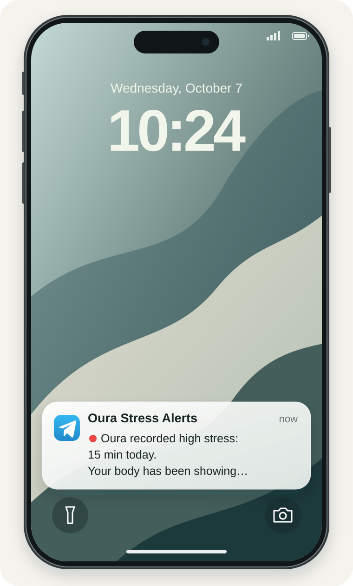

# Oura stress notification

A gentle Telegram nudge on your iPhone when Oura records more high stress.

Free and open source. Runs on your Mac or Linux computer. No coding required.

<p align="center">
  
  <br>
  <sub>Illustrative preview with example data. Appearance varies with notification settings.</sub>
</p>

Paste this into an agent with access to your computer:

```text
Set up https://github.com/fkb032/oura-stress-notification for me.
```
