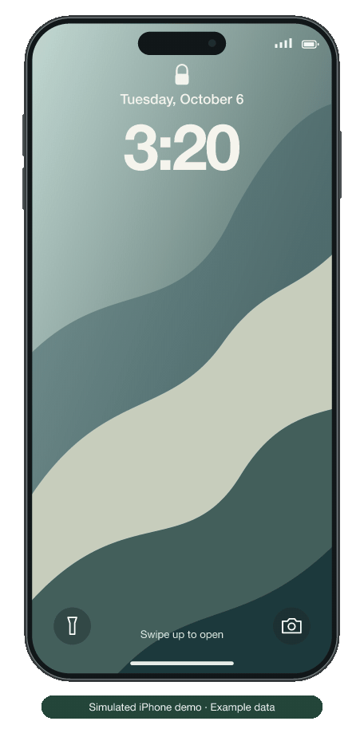

# Oura stress notification

A gentle push notification on your iPhone when Oura records more high stress. Free and open source.

Paste this into an agent with access to your computer:

```text
Set up https://github.com/fkb032/oura-stress-notification for me.
```

<p align="center">
  
</p>
