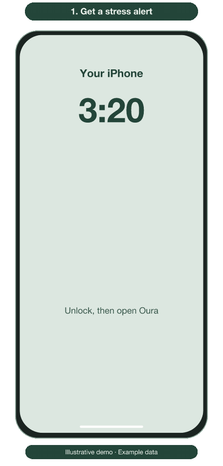

# Notification demos

Two simulated walkthroughs with example data: a Telegram stress alert arrives,
the person unlocks their iPhone, then opens Oura and taps Stress to see the recorded stress.
Tapping the Telegram notification itself opens Telegram. The Oura screen is a
mockup, and the timing is illustrative.

| Realistic simulation | Illustrated walkthrough |
|---|---|
|  |  |

[Static overview](images/stress-to-notification.svg)

The editable artwork source is [render_demos.mjs](images/render_demos.mjs).
Rendering uses Node with `@resvg/resvg-js` in a scratch folder, then ffmpeg to encode
8 fps GIFs from the 12 fps source frames (14 seconds per loop). These are artwork development tools;
the alert program still needs only Python's standard library.

[Static iPhone notification example](images/iphone-notification.svg)

## Rebuild the demos

Copy `images/render_demos.mjs` into a scratch directory, install
`@resvg/resvg-js` there, and run it with that directory as its output argument.
It writes 12 fps PNG sequences under `realistic/` and `illustrated/`. Helvetica
Neue is used when available; other systems fall back to Arial. The runtime alert
program never invokes this renderer.

Encode each sequence with the same palette and transparency settings:

```sh
ffmpeg -y -framerate 12 -i realistic/%04d.png \
  -filter_complex '[0:v]fps=8,split[a][b];[a]palettegen=max_colors=256:reserve_transparent=1[p];[b][p]paletteuse=dither=bayer:bayer_scale=4:alpha_threshold=128' \
  -loop 0 realistic-unoptimized.gif
gifsicle -O3 realistic-unoptimized.gif -o demo-realistic.gif
```

Repeat with `illustrated` in place of `realistic`. Compare decoded frames before
and after optimization, including transparent corners and the loop boundary.
The PNG source frames are development output and should stay out of Git.
